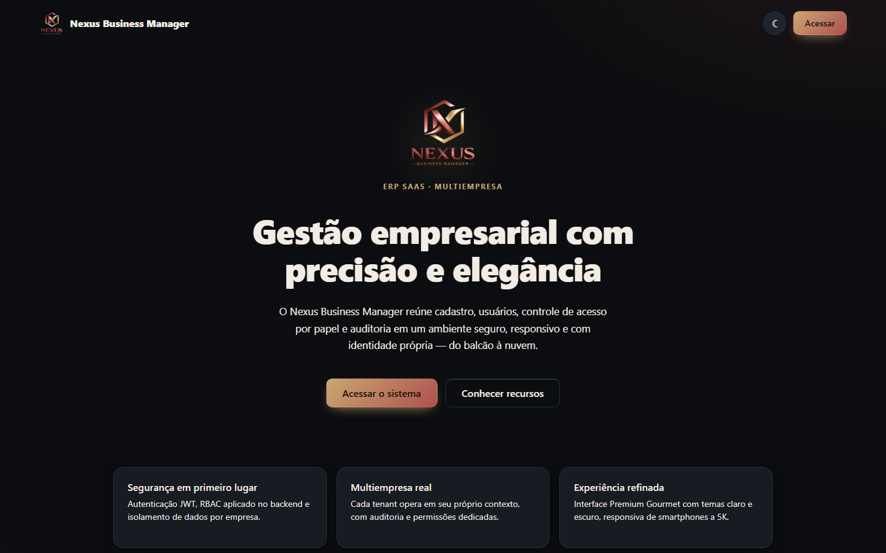
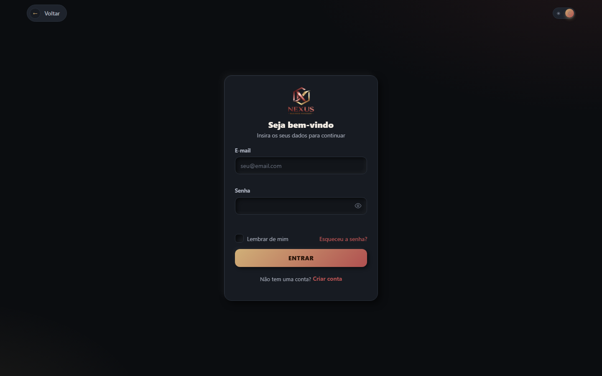
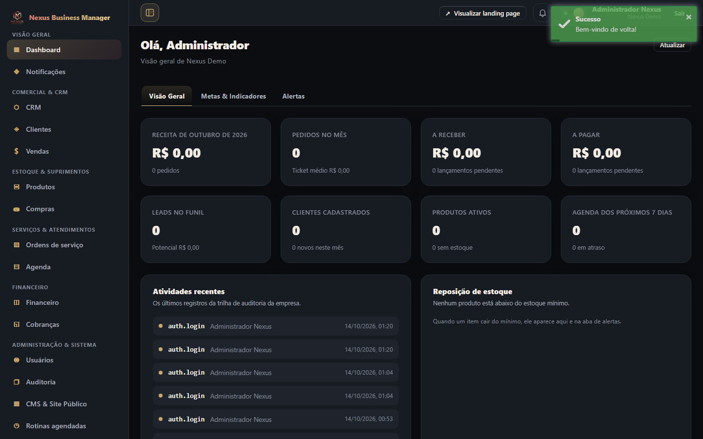
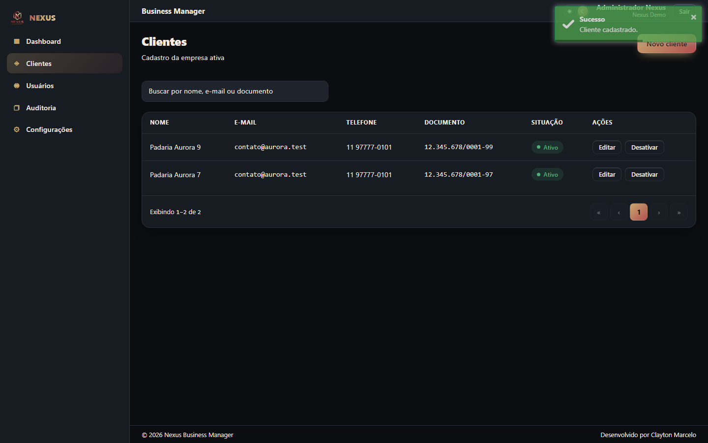
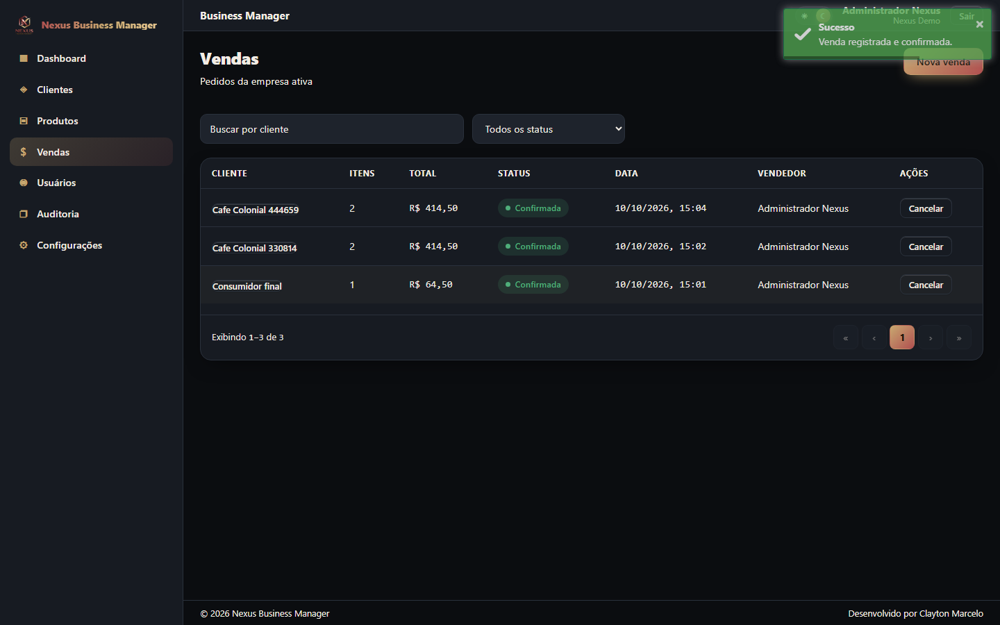
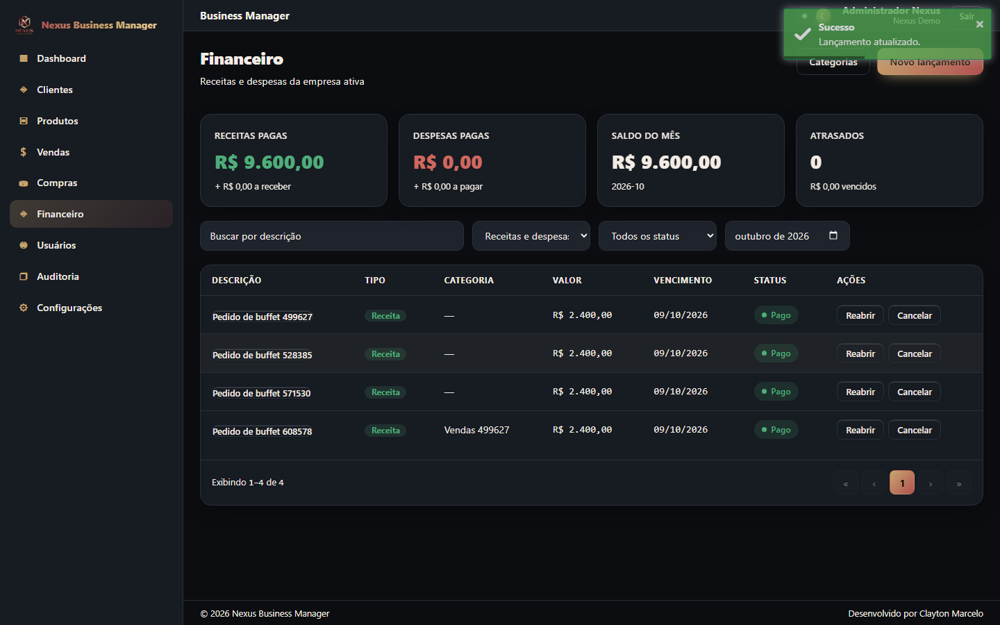

<p align="center">
  
</p> 
<h1 align="center">Nexus Business Manager</h1>


ERP SaaS multiempresa: clientes, produtos e estoque, vendas, compras, financeiro, CRM, agenda, ordens de serviço, cobranças, notificações, rotinas agendadas e a vitrine pública em um só painel.

      

## Telas

Seis telas reais do produto, capturadas em 1440×900. Cada imagem abre o arquivo capturado.

| Vitrine pública | Login | Painel |
| :--: | :--: | :--: |
| <a href="docs/screenshots/01-landing.png"></a> | <a href="docs/screenshots/02-login.png"></a> | <a href="docs/screenshots/03-dashboard.png"></a> |
| Clientes | Vendas | Financeiro |
| :--: | :--: | :--: |
| <a href="docs/screenshots/07-clientes.png"></a> | <a href="docs/screenshots/11-vendas.png"></a> | <a href="docs/screenshots/13-financeiro.png"></a> |

## O que a versão 1.0 entrega

- **Os quinze módulos do ERP:** clientes, produtos e estoque, vendas, compras e fornecedores, financeiro, CRM e pipeline, agenda, ordens de serviço, cobranças, notificações, equipe e permissões, auditoria, configurações, rotinas agendadas e o editor da vitrine.
- **Multiempresa de verdade:** duas camadas de administração (a plataforma e a empresa) e isolamento por construção — toda leitura e escrita parte do `companyId` da sessão, e um teste de intrusão ataca as rotas de uma empresa com os identificadores de outra.
- **LGPD dentro do produto:** aceite dos textos legais gravado no cadastro, cópia dos dados da pessoa em JSON, anonimização e exclusão do titular, cada direito exercido com trilha.
- **Segurança de operação:** JWT com refresh rotacionado, segundo fator TOTP, verificação de e-mail, limitador de taxa por rota, trilha de auditoria por ação, IP e origem.

O que ainda não está entregue — pagamentos, nota fiscal, licença, store compartilhado do limitador — está em [`docs/ROADMAP.md`](docs/ROADMAP.md), com o motivo de cada pendência.

## Como rodar

Pré-requisitos: Node.js 20 ou maior e um MySQL 8 com um banco vazio criado.

```bash
npm install
npm run db:migrate
npm run db:seed
npm run dev
```

Antes do `db:migrate`, copie `apps/api/.env.example` para `apps/api/.env` e ajuste `DATABASE_URL`, os dois segredos de JWT e as senhas que o seed exige (`SUPER_ADMIN_EMAIL`, `SEED_ADMIN_PASSWORD` e `SEED_DEV_PASSWORD`). Para a conta de desenvolvimento e a empresa de demonstração aparecerem, ligue também `SEED_DEV_ACCOUNT=1` e `SEED_DEMO_COMPANY=1` — no arquivo de exemplo as duas vêm desligadas de propósito. O `db:migrate` aplica o histórico versionado de migrations e o `db:seed` cria o administrador da plataforma, a conta de desenvolvimento e a empresa de demonstração. O painel sobe em `http://localhost:5173` e fala com a API em `3001`.

`npm run db:push` é atalho de desenvolvimento para reconstruir a estrutura do schema sem histórico de migrations — não é o caminho de uma instalação limpa.

## Produção

O painel e a API moram na **mesma origem**, na Vercel: o painel é o build do Vite e todo caminho `/api/*` cai numa Vercel Function (`api/[...path].ts`) que monta a mesma árvore de rotas do container. O banco é **TiDB Cloud Starter** (MySQL) ou um MySQL gerenciado. A ordem de publicação, as variáveis de ambiente, o backup e a restauração estão em [`docs/PRODUCAO.md`](docs/PRODUCAO.md); a pilha com Docker continua existindo em [`docker-compose.yml`](docker-compose.yml).

## Estrutura

```
apps/api      Fastify + Prisma
apps/web      React + Vite
docs/         estado, decisões, auditoria, ADRs e capturas
tools/        pilha de prova, capturas e provas de navegador
deploy/       backup, restauração e ambiente da Vercel
assets/       marca
```

## Documentação

Índice: [`docs/README.md`](docs/README.md). Estado medido do produto: [`docs/ESTADO-ATUAL.md`](docs/ESTADO-ATUAL.md). Achados abertos, um por um: [`docs/AUDITORIA.md`](docs/AUDITORIA.md). Decisões de desenho: [`docs/adr/`](docs/adr/) e [`docs/decisoes/`](docs/decisoes/).

## Autor

**Clayton Marcelo** — Desenvolvedor Full Stack

[GitHub](https://github.com/claytonmarcelo) · [LinkedIn](https://www.linkedin.com/in/clayton-marcelo-dev) · [Site](https://cmarcelodev.com)

## Licença

Ainda não existe arquivo `LICENSE`: o `package.json` declara `UNLICENSED`, e a licença do repositório é decisão pendente do dono ([`docs/decisoes/G6-licenca.md`](docs/decisoes/G6-licenca.md)).
