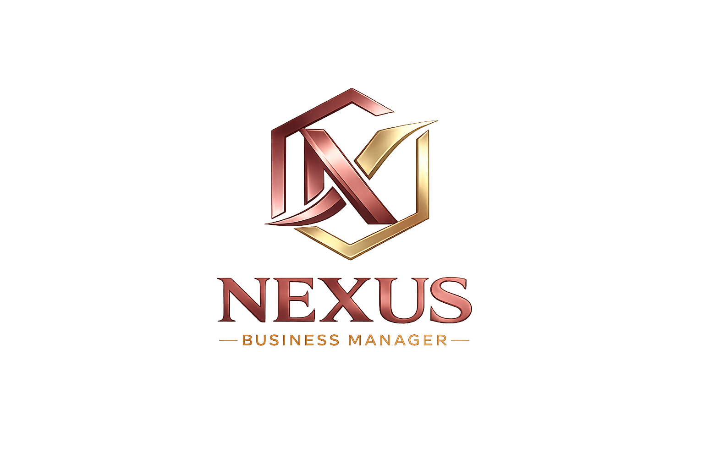
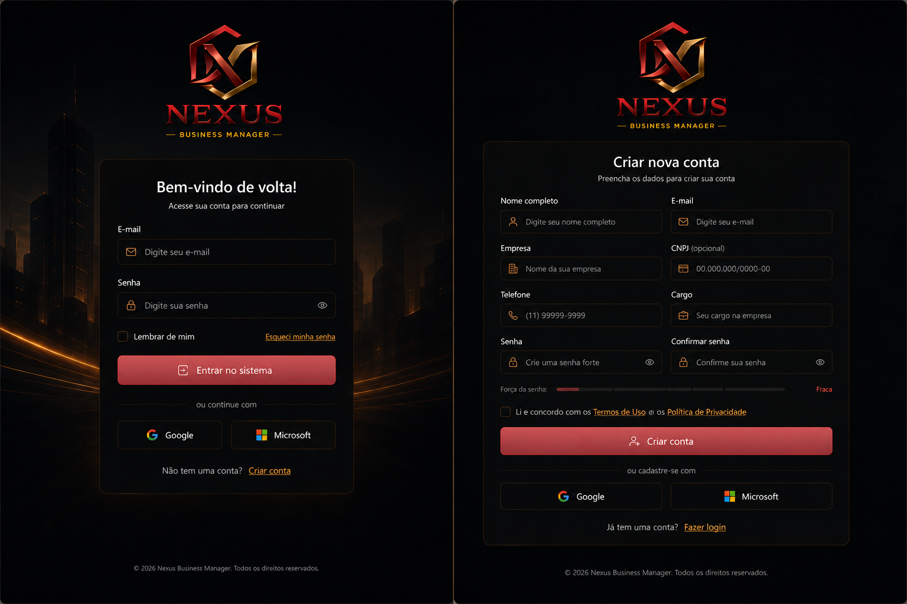
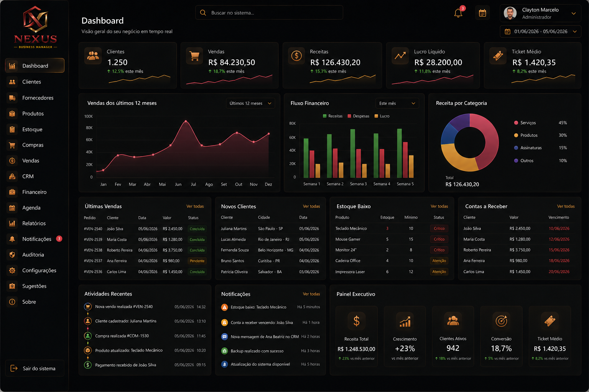
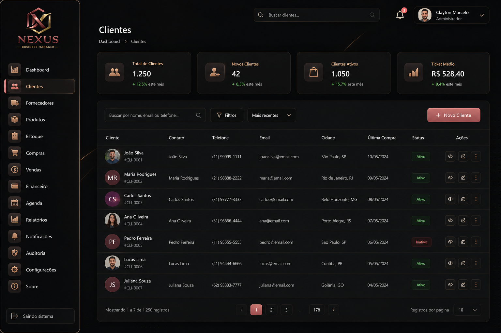
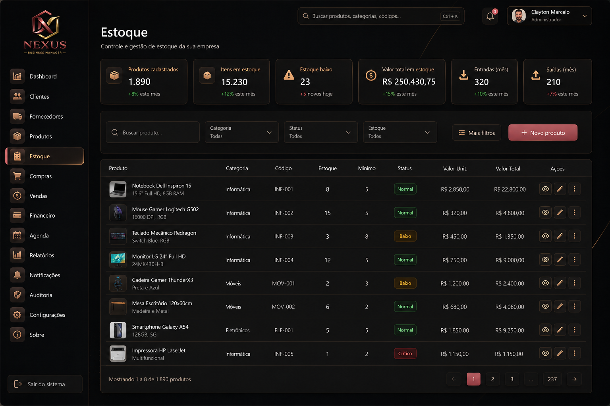
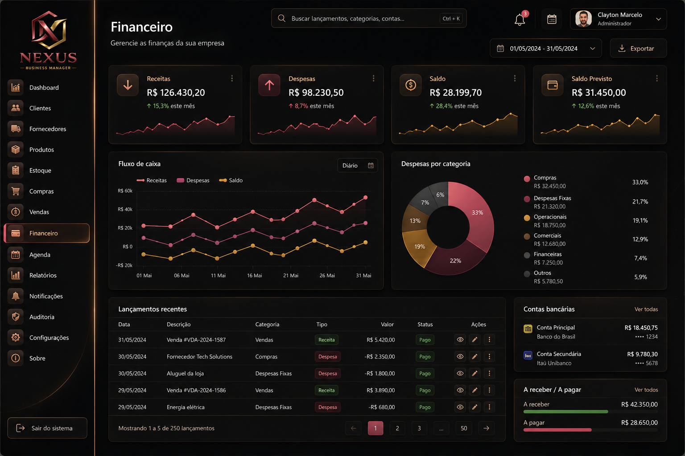
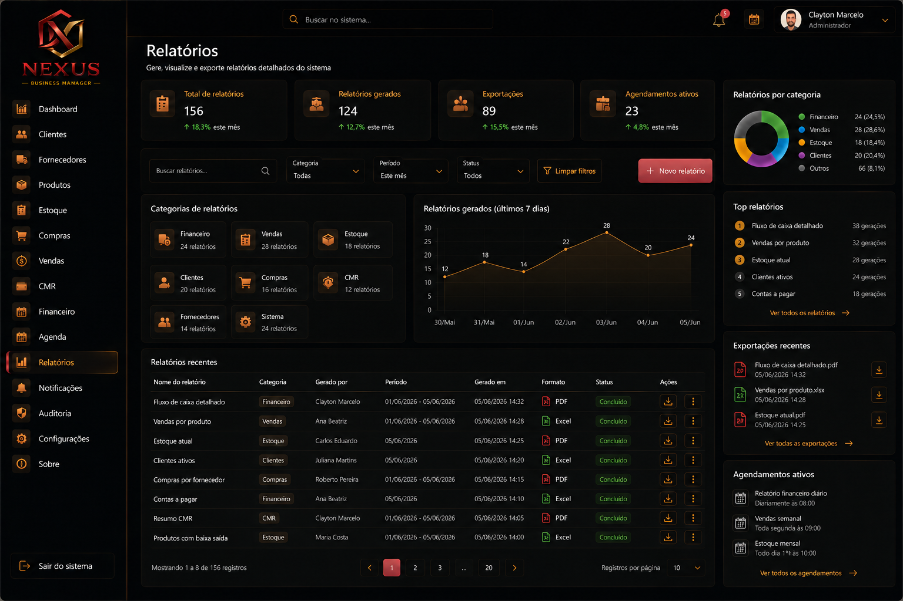

<p align="center">
  
</p>

<h1 align="center">NEXUS BUSINESS MANAGER</h1>

<p align="center">
  <strong>ERP SaaS completo — a gestão da empresa inteira em um só lugar</strong><br>
  Plataforma multiempresa para centralizar CRM, produtos, estoque, fornecedores, compras, vendas,
  financeiro, agendamentos, relatórios, notificações e auditoria no mesmo painel.
</p>

<p align="center">
  
  
  
  
  
  
  
  
</p>

<p align="center">
  <sub>Estágio atual: a versão 1.1.0 (24/06/2026) fechou os quinze módulos do ERP. Da fundação e da
  autenticação, pelos cadastros (CRM, produtos e fornecedores), pela operação (estoque, compras, vendas,
  financeiro e agenda), até o controle (dashboard, relatórios, notificações, auditoria e multiempresa).
  A tabela <a href="#módulos">Módulos</a> diz, um por um, o que está no ar.</sub>
</p>

<p align="center">
  <sub>Português · <a href="README.en.md">English</a></sub>
</p>

---

## Telas

Capturas ilustrativas da interface rodando, duas por linha e na mesma escala de exibição. Cada imagem
é um link: o clique abre o arquivo no tamanho capturado.

<div align="center">

| Login | Painel (dashboard) |
| :--: | :--: |
| <a href="assets/screenshots/login.png"></a> | <a href="assets/screenshots/dashboard.png"></a> |

| CRM · Clientes | Estoque |
| :--: | :--: |
| <a href="assets/screenshots/clientes.png"></a> | <a href="assets/screenshots/estoque.png"></a> |

| Financeiro | Relatórios |
| :--: | :--: |
| <a href="assets/screenshots/financeiro.png"></a> | <a href="assets/screenshots/relatorios.png"></a> |

</div>

---

## Sobre o projeto

O **Nexus Business Manager** é um ERP SaaS: ele acompanha a empresa por inteiro, do cadastro do cliente
e do produto até o relatório que fecha o período.

### Problema que resolve

Pequenas empresas costumam usar uma ferramenta para cada área: um sistema para clientes, uma planilha
para estoque, outro programa para finanças e uma agenda separada. O resultado é retrabalho, dado
inconsistente e tempo perdido conferindo uma fonte contra a outra.

O Nexus unifica essa cadeia em um fluxo só — fornecedor → compra → estoque → venda → financeiro →
relatório — com dados centralizados, acesso web, suporte a vários usuários, isolamento completo entre
empresas e cada ação registrada em auditoria.

### Para quem

- Lojas de varejo e atacado
- Prestadores de serviços (oficinas, consultórios, escritórios)
- Pequenas indústrias e distribuidoras
- Profissionais autônomos
- Escritórios de contabilidade

### O que a plataforma entrega

- **Centralização**: todos os dados da empresa em um só lugar
- **Economia**: substitui várias ferramentas pagas por um sistema único
- **Escalabilidade**: arquitetura modular, separada por domínio e preparada para crescer
- **Multiempresa**: isolamento por `company_id` em toda consulta, para gerenciar quantas empresas for preciso
- **Estoque que se move sozinho**: o recebimento da compra e a baixa da venda atualizam o estoque
- **Rastreabilidade**: criação, alteração, exclusão, login, logout e exportação ficam registrados com IP
- **Código aberto**: licença MIT, com liberdade para customizar e estender

---

## Funcionalidades no ar

São as telas e regras que existem hoje no repositório. O que ainda não está aqui está listado em
[Módulos](#módulos) e no [Roadmap](#roadmap), com a fase em que chega.

### Autenticação

- Login seguro com JWT, com expiração configurável em `JWT_EXPIRES_IN`
- Controle de sessão por token
- Senha guardada com hash bcryptjs e salt
- Limite de 5 tentativas de login e de 100 requisições por minuto no total
- Recuperação de senha

### Usuários e permissões

- Cadastro completo com perfis
- Hierarquia de permissões: `admin` > `manager` > `operator` > `viewer`
- Ativação e desativação de usuários

### Multiempresa

- Coluna `company_id` em toda tabela de dados e `WHERE company_id = ?` em toda consulta SQL
- O token JWT carrega o `companyId` do usuário logado, e o middleware de autenticação o extrai e repassa
- Cada usuário pertence a uma única empresa, e as empresas não visualizam dados umas das outras
- Cadastro e gerenciamento de empresas pelo módulo de administração

### CRM

- Cadastro de clientes com busca e paginação
- Histórico de vendas por cliente
- Status do cliente: ativo ou inativo

### Produtos

- Cadastro com SKU único
- Categorias e preços
- Controle de imagem do produto

### Estoque

- Movimentações de entrada e de saída
- Controle de quantidade por produto
- Alerta de estoque baixo
- Histórico completo de movimentações

### Fornecedores

- Cadastro com dados de contato
- Busca por nome e por documento

### Compras

- Pedidos com múltiplos itens
- Recebimento parcial
- Status: pendente, recebida ou cancelada
- Atualização automática do estoque ao receber

### Vendas

- Registro com múltiplos itens
- Baixa automática do estoque
- Vínculo com o cliente
- Status: aberta, concluída ou cancelada

### Financeiro

- Receitas e despesas
- Fluxo de caixa e relatório de fluxo de caixa
- Categorias personalizáveis
- Status: pendente, pago, vencido ou cancelado

### Agendamentos

- Calendário de serviços
- Vínculo com clientes
- Filtro por data
- Status: agendado, concluído ou cancelado

### Painel

- Indicadores de clientes, produtos, vendas e estoque baixo, e o valor total em estoque
- Gráfico de receitas contra despesas por mês, gráfico de vendas por mês e gráfico de produtos por categoria
- Cartões de indicador padronizados pelo componente reutilizável `StatsCard`, com cores temáticas
  (gold, green, blue, purple e rose)

### Relatórios e exportações

- Relatórios em JSON, PDF e Excel
- Cinco tipos: clientes, produtos, financeiro, estoque e vendas
- Download direto pelo navegador
- Cada exportação fica registrada na auditoria

### Notificações

- Alertas de estoque baixo, de contas a vencer e da agenda do dia
- Marcar como lida ou ler todas de uma vez

### Auditoria

- Registro de todas as ações: criação, alteração e exclusão
- Registro de login, de logout e de exportação de relatórios
- IP do usuário gravado em cada registro

### Configurações do sistema

- `system_settings` por empresa: nome do sistema, logo, favicon, cor primária e modo de tema

### Interface

- Sidebar adaptativo: a logo se ajusta ao estado (142,5 px expandido e 38 px retraído) com transição suave
- Escala visual 20% mais compacta: sidebar de 240 px, cabeçalho de 54 px, cartões de KPI de 110 px,
  espaçamento de 14 px e fontes de 0,85 rem
- Tabelas compactas, com fonte de 0,85 rem e padding de 10 px por 12 px
- Cartões de KPI padronizados em todas as páginas

---

## Módulos

Os quinze módulos do ERP estão no ar.

| Módulo | Status |
| --- | :---: |
| Autenticação | ✅ |
| Usuários | ✅ |
| CRM | ✅ |
| Produtos | ✅ |
| Estoque | ✅ |
| Fornecedores | ✅ |
| Compras | ✅ |
| Vendas | ✅ |
| Financeiro | ✅ |
| Agendamentos | ✅ |
| Dashboard | ✅ |
| Relatórios | ✅ |
| Notificações | ✅ |
| Auditoria | ✅ |
| Multiempresa | ✅ |

Legenda: ✅ no ar · 🚧 planejado, com a fase em que entra.

---

## Tecnologias

As versões exatas estão em `backend/package.json` e `frontend/package.json`; a coluna abaixo traz as
que a documentação do projeto fixa.

### Backend

| Tecnologia | Versão | Para quê |
| --- | --- | --- |
| Node.js | 20+ | Runtime da aplicação |
| Fastify | 4.28 | Framework HTTP |
| TypeScript | 5.5 | Tipagem estática |
| JWT | — | Autenticação stateless |
| Zod | — | Validação estrita de todas as entradas |
| bcryptjs | — | Hash de senhas |
| mysql2 | — | Driver MySQL |
| Prisma | — | ORM (módulo de autenticação) |

### Frontend

| Tecnologia | Versão | Para quê |
| --- | --- | --- |
| React | 18 | Biblioteca de UI |
| Vite | — | Bundler e dev server |
| Tailwind CSS | — | Estilos |
| React Native | 0.76 | Aplicativo mobile |
| Recharts | — | Gráficos |
| Axios | — | Cliente HTTP |

### Banco de dados

| Tecnologia | Versão | Para quê |
| --- | --- | --- |
| MySQL | 8+ | Banco relacional |
| Migrations | 24 | Evolução versionada do schema |
| Seeds | — | Dados iniciais e de demonstração |

### DevOps

| Tecnologia | Para quê |
| --- | --- |
| Git | Controle de versão |
| GitHub Actions | Pipeline de CI/CD |
| Vitest | Testes unitários |

---

## Estrutura de pastas

```text
nexusbusinessmanager/
├── backend/                 → API REST (Fastify + TypeScript)
│   ├── src/
│   │   ├── modules/         → 15 módulos de negócio
│   │   ├── shared/          → middlewares, utilitários e conexão com o banco
│   │   └── tests/           → testes unitários (Vitest)
│   └── database/
│       └── migrations/      → 24 migrações SQL versionadas
├── frontend/                → aplicação web (React + Vite)
│   └── src/
│       ├── pages/           → uma página por módulo
│       ├── components/      → componentes reutilizáveis
│       └── contexts/        → contexto de autenticação
├── database/                → schema SQL e scripts de backup
├── docs/                    → documentação completa
│   ├── en/                  → documentação em inglês
│   └── screenshots/         → capturas de tela
├── assets/
│   ├── branding/            → logo e recursos da marca
│   └── screenshots/         → as seis capturas deste README
├── .github/workflows/       → CI/CD (GitHub Actions)
├── CHANGELOG.md             → histórico por versão
├── INICIAR_SISTEMA.md       → guia rápido para subir o sistema
└── LICENSE                  → licença MIT
```

---

## Arquitetura

```text
┌──────────────────────────────────────────────────────────┐
│  1. CAMADA DE FRONT-END                                  │
├──────────────────────────────────────────────────────────┤
│  Navegador Web                                           │
│                                                          │
│  • React 18 + Vite                                       │
│  • Tailwind CSS                                          │
│  • Recharts (gráficos)                                   │
│  • Axios (cliente HTTP)                                  │
└──────────────────────────────────────────────────────────┘
                             │
                             │ HTTP + JWT
                             ▼
┌──────────────────────────────────────────────────────────┐
│  2. CAMADA DE APLICAÇÃO                                  │
├──────────────────────────────────────────────────────────┤
│  Fastify + Node.js + TypeScript                          │
│                                                          │
│  Fluxo de requisição:                                    │
│                                                          │
│  Rotas da API                                            │
│      ↓                                                   │
│  Middlewares (rate limit, Helmet, CORS)                  │
│      ↓                                                   │
│  Autenticação JWT (extrai o companyId)                   │
│      ↓                                                   │
│  Autorização por perfil (admin ... viewer)               │
│      ↓                                                   │
│  Validação de entrada (Zod)                              │
│      ↓                                                   │
│  15 módulos de negócio                                   │
│      ↓                                                   │
│  Persistência (mysql2)                                   │
└──────────────────────────────────────────────────────────┘
                             │
                             │ Consultas filtradas por company_id
                             ▼
┌──────────────────────────────────────────────────────────┐
│  3. CAMADA DE DADOS                                      │
├──────────────────────────────────────────────────────────┤
│  MySQL 8+                                                │
│  • 24 migrações versionadas                              │
│  • company_id em toda tabela de dados                    │
│                                                          │
│  ESTRUTURA FUNCIONAL                                     │
│                                                          │
│  ┌────────────────────────────────────────────────────┐  │
│  │ ACESSO E EMPRESAS                                  │  │
│  │ empresas ─ usuários ─ perfis                       │  │
│  └────────────────────────────────────────────────────┘  │
│  ┌────────────────────────────────────────────────────┐  │
│  │ CADASTROS                                          │  │
│  │ clientes ─ produtos ─ fornecedores                 │  │
│  └────────────────────────────────────────────────────┘  │
│  ┌────────────────────────────────────────────────────┐  │
│  │ OPERAÇÃO                                           │  │
│  │ estoque ─ compras ─ vendas                         │  │
│  │ financeiro ─ agenda                                │  │
│  └────────────────────────────────────────────────────┘  │
│  ┌────────────────────────────────────────────────────┐  │
│  │ GESTÃO INTERNA                                     │  │
│  │ notificações ─ auditoria                           │  │
│  │ configurações do sistema                           │  │
│  └────────────────────────────────────────────────────┘  │
└──────────────────────────────────────────────────────────┘
```

A regra de dependência é uma só: o middleware de autenticação extrai o `companyId` do token e o repassa,
e toda consulta SQL filtra por `company_id`. O backend é modular e separado por domínio, cada um dos
quinze módulos com a própria responsabilidade, e a mesma API REST atende o frontend web.

---

## Banco de dados

**MySQL 8+**, com o schema versionado em 24 migrações em `backend/database/migrations/`, executadas em
ordem numérica. Chaves estrangeiras completas, 21 índices de performance nas tabelas principais
(vendas, compras, produtos, clientes e outras) e `company_id` em toda tabela de dados.

```bash
npm run migrate    # aplica o schema, em ordem numérica
npm run seed       # administrador e empresa padrão
npm run demo-seed  # dados de demonstração realistas (clientes, produtos, vendas e mais)
```

`seed` não é opcional: sem ele não há administrador nem empresa, e o login cai numa instalação vazia.

---

## Instalação

### Pré-requisitos

- Node.js 20 ou superior
- MySQL 8.0 ou superior
- Git
- npm (incluído com o Node.js)

### Passo a passo

```bash
# 1. Clone o repositório
git clone https://github.com/claytonmarcelo/Nexus-Business-Manager.git
cd Nexus-Business-Manager

# 2. Crie o schema no MySQL
mysql -u root -p < database/schema.sql

# 3. Instale e inicie o backend
cd backend
npm install
cp .env.example .env
# Edite o .env com as suas credenciais (veja Configuração abaixo)

npm run migrate
npm run seed
npm run dev

# 4. Em outro terminal, instale e inicie o frontend
cd frontend
npm install
npm run dev
```

A API sobe em `http://localhost:3333` e o frontend em `http://localhost:5173`.

### Contas e acesso

O `npm run seed` cria o administrador e a empresa padrão. O `npm run demo-seed` popula o banco com a
empresa de demonstração e a conta descrita em [Demonstração](#demonstração).

---

## Configuração

As variáveis de ambiente vivem no `.env`, dentro de `backend/`. O ponto de partida é o `.env.example`,
que traz as chaves nomeadas e valores de exemplo.

| Variável | Para quê |
| --- | --- |
| `PORT` | Porta da API (`3333`) |
| `NODE_ENV` | Modo de execução (`development`) |
| `LOG_LEVEL` | Nível de log (`debug`) |
| `JWT_SECRET` | Segredo que assina os tokens — troque o valor de exemplo |
| `JWT_EXPIRES_IN` | Validade do token (`8h`) |
| `DB_HOST`, `DB_PORT` | Endereço do MySQL (`localhost`, `3306`) |
| `DB_NAME` | Nome do banco (`nexus_business_manager`) |
| `DB_USER`, `DB_PASSWORD` | Credenciais do MySQL |

---

## Segurança

| Camada | Como está implementado |
| --- | --- |
| Senha | Hash bcryptjs com salt; nunca em texto claro |
| Autenticação | Token JWT com expiração configurável em `JWT_EXPIRES_IN` |
| Força bruta | 100 requisições por minuto no total e 5 tentativas de login |
| Cabeçalhos HTTP | Helmet: proteção contra XSS, CSP e HSTS |
| Validação | Zod, com validação estrita de todas as entradas |
| Autorização | Hierarquia `admin` > `manager` > `operator` > `viewer` |
| Tenancy | `company_id` em toda tabela e em toda consulta; o `companyId` viaja no token |
| Auditoria | Todas as ações, login, logout e exportação gravados com IP e data |
| CORS | Controle das origens permitidas |
| Segredos | Credenciais no `.env`; o `.env.example` traz só valores de exemplo |

---

## Testes

Os testes unitários do backend usam **Vitest** e ficam em `backend/src/tests/`. A execução e a cobertura
estão em [docs/tests.md](docs/tests.md). O pipeline de CI/CD roda no GitHub Actions
(`.github/workflows`).

Estado da última verificação (v1.1.0):

- Frontend: `tsc --noEmit` e `vite build` sem erro
- Backend: `npm run build` com TypeScript sem erros
- Banco: as 24 migrações aplicam sem erro

---

## Documentação

A documentação completa está na pasta `docs/`.

| Documento | Descrição |
| --- | --- |
| [Arquitetura](docs/arquitetura.md) | Diagramas e fluxos do sistema |
| [Deploy](docs/deploy.md) | Guia de implantação em produção |
| [Backup](docs/backup.md) | Backup e restauração do banco |
| [Monitoramento](docs/monitoramento.md) | Health check e logs |
| [Testes](docs/tests.md) | Execução e cobertura de testes |
| [Casos de uso](docs/use-cases.md) | Exemplos reais de aplicação |
| [Conta demo](docs/demo-account.md) | Credenciais de demonstração |
| [Licença](docs/license-pt-br.md) | Explicação da licença MIT |

---

## Demonstração

Não há demonstração online: o projeto roda localmente. A demonstração de dados é um seeder, que popula
o banco com dados realistas:

```bash
cd backend
npm run demo-seed
```

Depois, com o backend e o frontend no ar, acesse `http://localhost:5173` e entre com:

- **E-mail:** `admin@nexusdemo.com`
- **Senha:** `123456`

É conta de demonstração local: troque a senha antes de qualquer uso fora da sua máquina.

---

## Roadmap

### Concluído

- [x] Fundação do projeto: estrutura, design system e banco
- [x] Autenticação: login, JWT e permissões
- [x] Dashboard com indicadores e gráficos
- [x] CRM completo: clientes e histórico
- [x] Controle de estoque: produtos e movimentações
- [x] Gestão financeira: contas e fluxo de caixa
- [x] Agendamento: calendário e eventos
- [x] Arquitetura multiempresa (SaaS)
- [x] Relatórios exportáveis em PDF e Excel
- [x] Notificações e auditoria
- [x] Pipeline de CI/CD
- [x] Testes unitários automatizados
- [x] Documentação completa e bilíngue
- [x] **v1.1.0** — Interface 20% mais compacta
- [x] **v1.1.0** — Banco com 24 de 24 migrações e chaves estrangeiras completas
- [x] **v1.1.0** — `StatsCard` padronizado em todas as páginas
- [x] **v1.1.0** — Logo adaptativo no sidebar
- [x] **v1.1.0** — Grafo de conhecimento do código (Graphify)

### A seguir

**Fase 9 — Marketplace de aplicativos.** Área para integrar módulos, extensões e serviços externos ao
Nexus Business Manager. Possibilidades: WhatsApp, Google Calendar, Google Drive, PIX, Stripe,
Mercado Pago, aplicativos internos, plugins empresariais e extensões por empresa.
Status: planejado.

**Fase 10 — BI e inteligência de negócios.** Camada de análise estratégica para transformar dado
operacional em indicador gerencial. Possibilidades: dashboards avançados, KPIs personalizados, gráficos
comparativos, análise de vendas e financeira, previsão de estoque, relatórios executivos e exportação
analítica. Status: planejado.

---

## Histórico de versões

O detalhamento por versão está em [CHANGELOG.md](CHANGELOG.md). A versão atual é a **1.1.0**
(24/06/2026):

- **Interface**: sidebar adaptativo, escala visual 20% mais compacta, cartões de KPI padronizados com
  `StatsCard` e tabelas compactas
- **Banco**: 24 migrações aplicando sem erro, chaves estrangeiras completas (`audit_logs`, `crm_leads`,
  `suggestions`), `system_settings` expandido, coluna `user_id` em `notifications` e 21 índices de
  performance nas tabelas principais
- **Build e qualidade**: `tsc --noEmit` e `vite build` no frontend, `npm run build` no backend e
  migrações 24 de 24, todos sem erro; grafo do código com 1.099 nós, 2.021 arestas e 133 comunidades

---

## Desenvolvedor

<table>
  <tr>
    <td width="90" align="center">
      
    </td>
    <td>
      <strong>Clayton Marcelo</strong> — C. Marcelo Dev.<br>
      Full stack — React, React Native, Node.js, Fastify, TypeScript, MySQL<br><br>
      <a href="https://github.com/claytonmarcelo"></a>
      <a href="https://www.linkedin.com/in/clayton-marcelo-dev/"></a>
      <a href="https://www.youtube.com/@c.marcelodev.brasil"></a>
      <a href="https://cmarcelodev.com"></a>
    </td>
  </tr>
</table>

---

## Licença

Este projeto é licenciado sob a **Licença MIT** — veja o arquivo [LICENSE](LICENSE). Explicação
simplificada: [Português](docs/license-pt-br.md) · [English](docs/en/license-en.md).

---

<p align="center">
  <sub>NEXUS BUSINESS MANAGER · Clayton Marcelo · 2026</sub>
</p>
